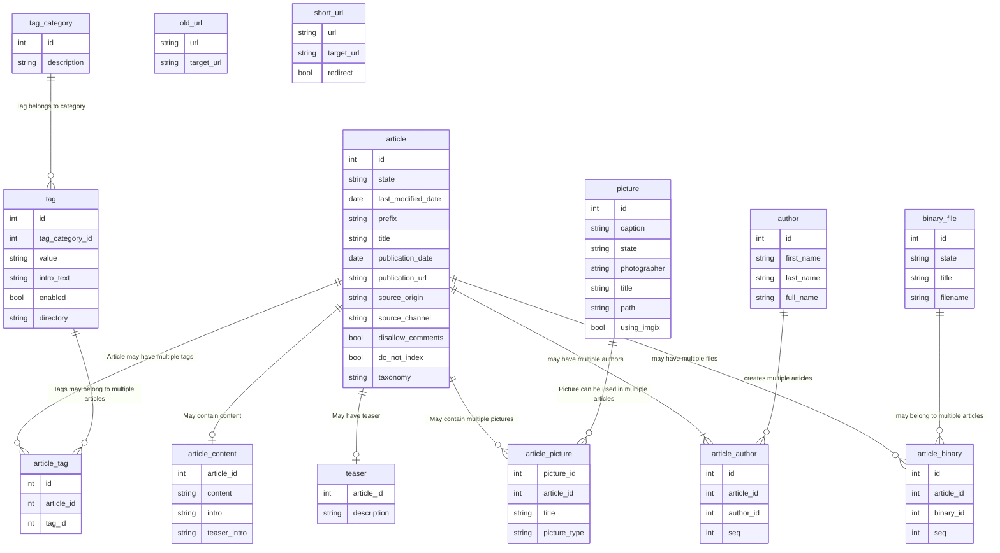

# Import readme

## Import order

Because some content has dependencies to be rendered / imported correctly, it's required to import content in a specific order. The order is as follows:

1. [Genres (taxonomy)](./genres_readme.md)
2. [Tag -> Categories (taxonomy)](./tags_readme.md)
3. [Sections (taxonomy)](./sections_readme.md)
4. [Picture files as Media](./pictures_readme.md)
5. Binary files as Media
6. [Author as Team](./authors_readme.md)
7. Articles
8. Podcast series (taxonomy)
9. Podcasts
10. Redirects
11. Short URL as redirect
12. Run import of Pictures and Binary files again.

## Table structure



### article => post

- id
- escenic_id -> Oude CMS
- state -> Status
- X target_state -> Is altijd publish als het ingevuld is en alleen van toepassing bij embargo
- last_modified_date
- X embargoed_until_date -> Hoeft niet mee omdate we FUTURE post status gebuiken
- X broadcast_date -> Overal null dus hoeft niet mee
- X teaser_title -> Komt uit teaser tabel
- prefix -> Genre taxonomie
- title
- publication_date
- publication_url
- source_origin -> belangrijk?
- source_channel -> belangrijk?
- X third_party -> overal leeg
- X topic -> overal leeg
- disallow_comments
- show_related_articles --> belangrijk?
- short_article --> belangrijk? Alleen oude artikelen en 'Kort' is ook een prefix
- X special_card --> Altijd leeg
- do_not_index
- X original_article_id --> Van oude import
- X uri --> Van oude import, afgehandeld met redirects
- X source_id --> Niet nuttig
- X article_type --> Gaat niet mee, filter op ARTICLE
- X new_window --> Overbodig
- X redirect_url --> nvt op ARTICLE article_type
- X full_width --> nvt
- X top_html_content_item_id --> nvt
- free --> of er een paywall getoond moet worden
- X taxonomy --> Leeg
- X article_length --> Leeg
- X version --> nvt
- X last_update_date --> Leeg
- X canonical_url --> Leeg
- X do_auto_tag --> Leeg
- X category --> Leeg
- X template --> NEWS, 101 met BACKGROUND. Nodig? Eventueel handmatig.

### author => team

- id
- first_name
- last_name
- full_name
- X type --> always 1
- X esb_id --> irrelevant

### binary_file => media

- id
- X escenic_id --> irrelevant
- state (PUBLISH or DRAFT)
- X alignment (RIGHT, LEFT of BLOCK) --> irrelevant
- X version --> irrelevant
- filename
- x binary_type --> is always pdf

### picture => media

- id
- caption
- X escenic_id --> irrelevant
- state --> status DELETED is skipped
- photographer
- title
- X version --> irrelevant
- X alignment --> irrelevant
- X original_width --> irrelevant
- X original_height --> irrelevant
- path
- using_imgix -> always 0 in energeia
- X source_url --> empty
- X source_id --> empty

### tag => category

- id
- tag_category_id --> taxonomy id (is always 1)
- value      --> term_name
- intro_text --> description
- enabled
- X kvk_number --> empty
- directory   --> slug
- X image_path --> empty

### old_url => redirect

Redirects tabel

- url
- target_url
- X old_url_pattern --> nvt

### short_url => redirect

Andere redirects tabel?

- url
- target_url
- redirect

### section => section

- name
- title
- parent_name
- directory
- full_path

### teaser

Excerpts maar moeilijker

- article_id
- X type --> nvt
- X picture_id --> nvt
- X title --> nvt
- description

## Queries

These are some useful queries, which are not directly required for the import.

### Select items with duplicate titles:

```sql
SELECT title
FROM article
GROUP BY title
HAVING count(title) > 1
```

```sql
SELECT id,state,last_modified_date,title,publication_date,publication_url,taxonomy,version FROM article WHERE title IN (
	SELECT title
	FROM article
	GROUP BY title
	HAVING count(title) > 1
);
```

## FDMG tags

Due to multiple migrations and the way content in webrwiter is structured, some custom HTML tags are present in the content. These custom HTML tags need to be replaced with actual HTML. Below is a list of custom HTML elements.

### FDMG PDF

```html
<fdmg-pdf>
	<fdmg-id>npfile-6d0e1a914de7e44ae07ba1651d8cf6a3</fdmg-id>
	<fdmg-filename>WsZLLnV5ILYhtKSI0WBunGkiZBE.pdf</fdmg-filename>
	<fdmg-title>Muns (2016) ESB 4739 538-539.pdf</fdmg-title>
</fdmg-pdf>
```

### FDMG Image

```html
<fdmg-image>
	<fdmg-id>20001203</fdmg-id>
	<fdmg-filename>archive/20001203_hh-14979262.jpg</fdmg-filename>
	<fdmg-width>NaN</fdmg-width>
	<fdmg-height>NaN</fdmg-height>
	<fdmg-caption>Bron: Hollandse Hoogte / Anke Teunissen</fdmg-caption>
	<fdmg-alt-text />
	<fdmg-credit />
	<fdmg-alignment>block</fdmg-alignment>
</fdmg-image>
```
